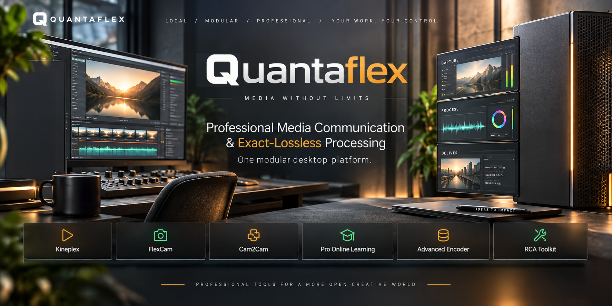

  

# Quantaflex Community

Quantaflex is an independently developed professional media platform built around exact-lossless processing, local-first workflows, and modular tools for creators, educators, researchers, and technical users.

This repository is the public community home for Quantaflex.

It contains:

- public product information
- roadmap updates
- community discussions
- sponsorship information
- release announcements
- contribution guidance

It does **not** contain Quantaflex production source code, codec implementation details, proprietary algorithms, internal development branches, or confidential research material.

## Quantaflex Products

The Quantaflex platform includes:

- **Kineplex** — Home Theatre
- **FlexCam** — Social Video Edit & Posting Suite
- **Cam2Cam**
- **Pro Online Learning**
- **Advanced Encoder**
- **RCA Toolkit**

Quantaflex desktop software will also be available through the official Shopify store as a permanent commercial licence.

## Community Funding

From **15 October 2026**, Quantaflex will also offer community sponsorship.

Sponsorship helps fund:

- continued product development
- new features and modules
- testing across hardware and operating systems
- documentation
- research
- experimental builds
- future Quantaflex technologies

Sponsor access does **not** include access to Quantaflex proprietary source code or confidential development repositories.

### Sponsorship Levels

**£5 / €6 per month — Quantaflex Supporter**

- access to the Quantaflex desktop application while sponsorship is active
- community access
- development updates
- release notes
- supporter recognition

**£10 / €12 per month — Quantaflex Builder**

Everything in Supporter, plus:

- early access to new product features
- beta builds
- roadmap previews
- community voting on development priorities

**£20 / €24 per month — Quantaflex Pioneer**

Everything in Builder, plus:

- experimental builds
- prototype features
- deeper technical development notes
- selected benchmark and testing material
- optional Pioneer acknowledgement

**£50 / €60 per month — Quantaflex Sponsor**

Everything in Pioneer, plus:

- periodic roadmap briefings
- priority consideration for workflow and compatibility requests
- sponsor acknowledgement

Commercial and industry sponsorship options will also be introduced.

## Buy Quantaflex

Users who prefer a permanent licence will be able to purchase Quantaflex directly through the official Shopify store.

Sponsorship and permanent licensing are separate routes.

## Official Sites

Product website:

https://www.quantaflex.co.uk

Community website:

https://www.quantaflex.net

## Discussions

GitHub Discussions will be used for:

- feature ideas
- product feedback
- workflow discussions
- release conversations
- community questions
- roadmap discussion

## Intellectual Property

Quantaflex development repositories remain private.

This repository exists to support the public community without exposing proprietary source code, codec design, experimental algorithms, or confidential development material.

© 2026 Quantaflex. All rights reserved.
